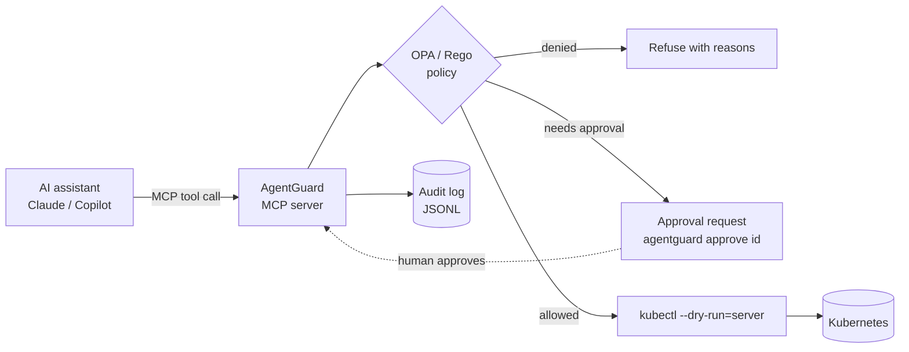

# AgentGuard


**Let AI agents operate Kubernetes — without letting them break production.**

AgentGuard is a [Model Context Protocol](https://modelcontextprotocol.io) (MCP) server that gives AI assistants such as Claude or VS Code Copilot real Kubernetes tools (diagnose, logs, events, restart, scale, rollback) — and puts a **policy-as-code guardrail** in front of every single call:

- **OPA/Rego decides** what the agent may do, per tool, namespace and argument. It fails closed.
- **Humans approve** risky changes. Approvals are bound to the exact action, expire, and are single-use.
- **Dry-run first.** Every change is validated by the API server (`--dry-run=server`) before it runs.
- **Everything is audited** to an append-only log: what the agent asked, what policy decided, and why.

## Why

Teams want AI agents on call — reading alerts, finding root causes, rolling back bad releases. The blocker is trust: an LLM with `kubectl` and cluster-admin is one hallucination away from `delete namespace prod`. AgentGuard moves that trust boundary out of the prompt and into **code that can be reviewed, tested and versioned** — the same way platform teams already govern CI/CD pipelines.

## How it works



## Guardrails (in [`policy/agentguard.rego`](policy/agentguard.rego), configured in [`policy/config/data.json`](policy/config/data.json))

| Rule | Effect |
|---|---|
| Tool not on the allow-list (e.g. `exec`, `delete namespace`) | ⛔ denied |
| Any change in `kube-system` and other protected namespaces | ⛔ denied |
| Scale above 10 replicas, or more than 2× in one step | ⛔ denied |
| Scale a `prod` workload to zero | ⛔ denied, even with approval |
| More than 5 changes in 10 minutes (blast-radius limit) | ⛔ denied |
| Change freeze active (`AGENTGUARD_CHANGE_FREEZE=true`) | ⛔ denied |
| Any change in `prod`, or scaling down by more than half | ⏸️ human approval required |
| Reads (pods, logs, events, deployments, diagnosis) | ✅ allowed, still audited |

## Proof: a live incident in CI

On every push, GitHub Actions starts a real Kubernetes cluster (kind), deploys a `web` service to `staging` and `prod`, ships a **broken release** to staging, and then a scripted agent drives AgentGuard over MCP — exactly as an LLM would:

| Step | Outcome |
|---|---|
| Diagnose staging → finds `ImagePullBackOff` on the new release | ✅ |
| Roll back the bad release, verify recovery | ✅ |
| Delete a `kube-system` pod | ⛔ protected namespace |
| Scale prod 2 → 50 / to zero | ⛔ policy limits |
| Restart prod | ⏸️ approval required |
| Retry before a human approves / reuse the approval | ⛔ |
| Human runs `agentguard approve <id>` → restart prod | ✅ |

The full step-by-step table appears on each run's **Summary** page, and the audit log is attached as an artifact.

## Tools exposed to the agent

| Read-only | Changes (policy-checked) |
|---|---|
| `diagnose_namespace`, `list_pods`, `get_pod_logs`, `get_events`, `describe_deployment`, `get_audit_log` | `restart_deployment`, `scale_deployment`, `rollback_deployment`, `delete_pod` |

Tools carry MCP annotations (`readOnlyHint`, `destructiveHint`) so clients can show the right confirmation UI.

## Run it locally

Requirements: Python 3.11+, `kubectl`, the [OPA CLI](https://www.openpolicyagent.org/docs/latest/#running-opa), and a cluster (e.g. [kind](https://kind.sigs.k8s.io/) on Docker Desktop).

```bash
git clone https://github.com/nareshsaw/agentguard && cd agentguard
python3 -m venv .venv && source .venv/bin/activate
pip install -e ".[dev]"

pytest -v                 # unit + MCP protocol tests (uses a fake kubectl)
opa test policy/ -v       # policy tests

kind create cluster --name agentguard
kubectl apply -f e2e/demo-app.yaml
```

Connect it to **Claude Desktop** (Settings → Developer → Edit Config) using [`docs/claude_desktop_config.json`](docs/claude_desktop_config.json), then ask:

> *"Something is wrong in staging. Find out what and fix it."*

When the agent asks for approval, approve it from a terminal:

```bash
agentguard pending          # what is waiting for a human
agentguard approve apr-1a2b3c4d
agentguard audit -n 20      # what happened and why
```

## Design decisions

- **Policy outside the prompt.** System prompts can be ignored or injected; a Rego decision can't. Policies are unit-tested (`opa test`) and change through pull requests.
- **Fail closed.** If OPA is missing or errors, every call is denied.
- **Approvals bind to intent.** An approval is a hash of tool + namespace + arguments, so an approval for `restart web` can't be reused to `delete db`.
- **Least privilege underneath.** Run AgentGuard with a Kubernetes ServiceAccount limited to the verbs it exposes; policy is defence in depth, not a replacement for RBAC.

## Roadmap

- Run OPA as a sidecar/server and load policies as signed bundles
- Export decisions as OpenTelemetry traces
- Slack / Teams approval buttons instead of the CLI
- Namespace-label-driven rules (e.g. `env=prod`) instead of name lists

## Results

<!-- Add a screenshot of the CI Summary table and of Claude fixing staging via AgentGuard -->

## What I learned

<!-- 3–5 points in your own words -->

## License

MIT
